# Diagrama de estados de una incidencia

**Estado:** Diagrama de referencia contrastado con las transiciones descritas en S01–S04. La prueba final debe ejecutarse contra el commit que se entregue.

```mermaid
stateDiagram-v2
    [*] --> REGISTRADA: solicitante registra

    REGISTRADA --> ASIGNADA: coordinador asigna técnico activo
    ASIGNADA --> EN_ATENCION: técnico asignado inicia atención
    EN_ATENCION --> PENDIENTE_VALIDACION: técnico registra solución

    PENDIENTE_VALIDACION --> CERRADA: solicitante dueño confirma
    PENDIENTE_VALIDACION --> EN_ATENCION: solicitante dueño rechaza con motivo válido
    CERRADA --> EN_ATENCION: solicitante dueño reabre hasta 48 h desde el último cierre

    note right of PENDIENTE_VALIDACION
        Al rechazar, se conserva
        la solución anterior.
    end note

    note right of EN_ATENCION
        Rechazo y reapertura conservan
        el mismo técnico asignado.
    end note

    note right of CERRADA
        Cada cierre se conserva
        como un registro histórico.
    end note
```

## Reglas para operaciones rechazadas

Si una acción no tiene permiso, el estado no corresponde, el motivo no cumple la longitud o se excede el plazo, la incidencia conserva su estado y no se agrega un evento al historial. La reapertura acepta el instante exacto de las 48 horas y rechaza un instante posterior.
