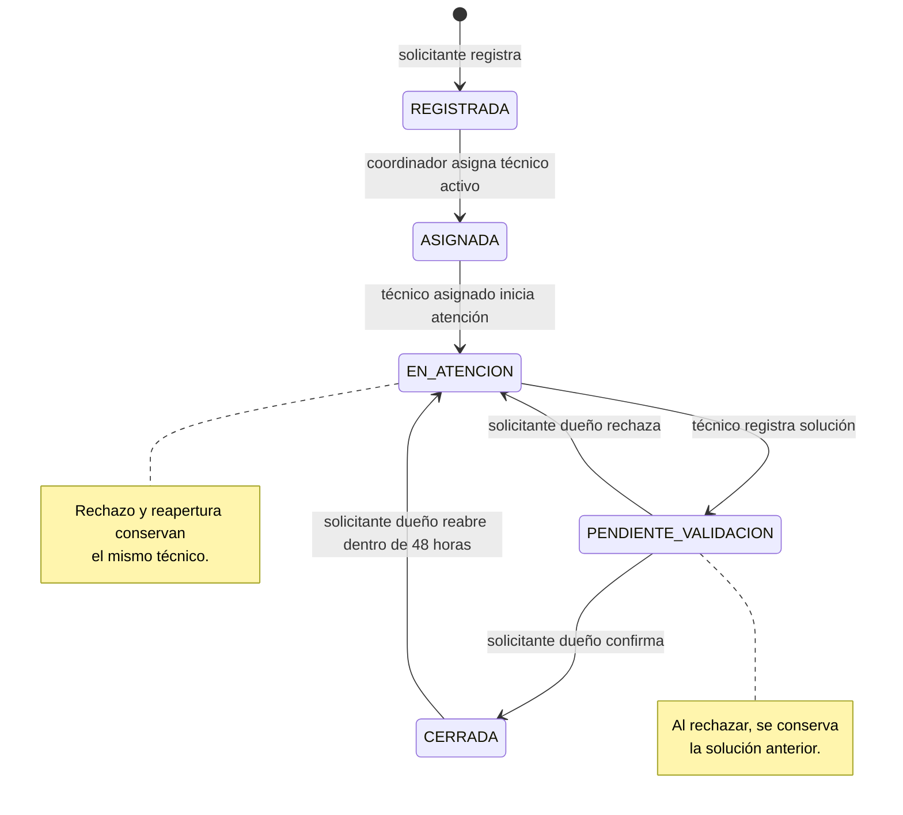

# Diagrama de estados de una incidencia

**Estado:** Borrador, pendiente de revisión con las SPECS.

## Regla para operaciones rechazadas

Si una acción no tiene permiso, el estado no corresponde o los datos no son válidos, la incidencia conserva su estado y no se agrega un evento al historial.
