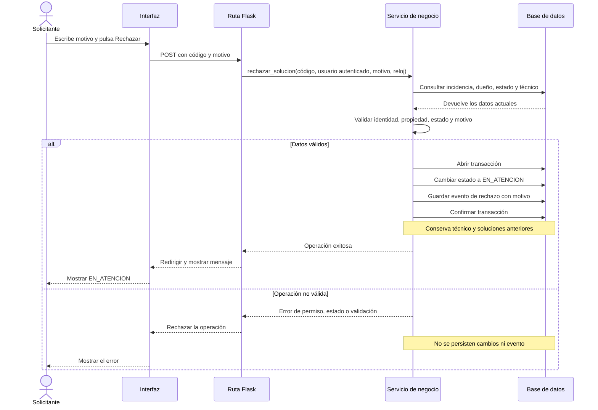

# Secuencia: rechazar una solución

**Estado:** Diagrama de referencia alineado con el flujo de ruta → servicio → base de datos. Confirmar contra la implementación si cambian las rutas o el modelo.

El diagrama representa el flujo esperado y no es evidencia por sí mismo. La prueba de integración debe verificar tanto el caso exitoso como la ausencia de efectos parciales en el rechazo.
