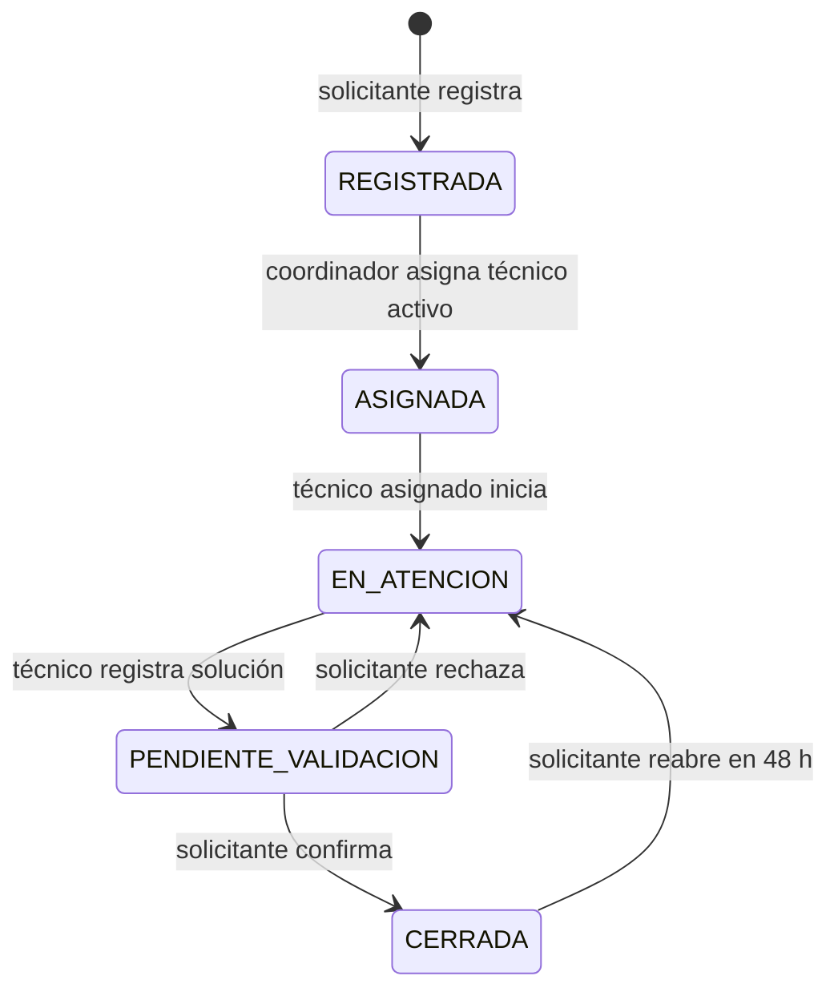
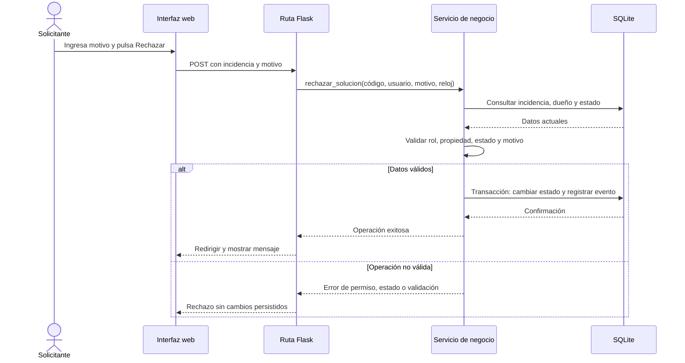

# Entrega 06 — ReparaCampus

> Documento de trabajo que se completará progresivamente. No marcar funcionalidades, pruebas o revisiones como terminadas sin evidencia verificable. Los campos entre corchetes están pendientes de confirmar.

## Control del documento
- Versión: 0.1 — estructura inicial
- Estado: En construcción
- Repositorio: https://github.com/cbalmaooo/reparacampus
- Tag evaluado: [crear/verificar al cierre]
- SHA exacto: [registrar al congelar la versión]
- Fecha de cierre: [pendiente]

## 1. Portada

**Universidad Simón Bolívar**  
**Programa:** Ingeniería de Sistemas  
**Asignatura:** Ingeniería de Software I  
**Título:** Examen — Entrega 06: ReparaCampus  
**Equipo:** Team Equihire  
**Docente:** Adriana María Iglesias Solano  
**Fecha de entrega:** 13 de octubre de 2026

### Integrantes

| Integrante | Código estudiantil |
|---|---|
| Alejandro Borja | 202511276804 |
| Alejandro Barros | 202511275916 |
| Sebastian Oyaga | 202511270424 |
| Taliana Reyes | 2025511272254 |

> **Pendiente de confirmar:** denominación oficial completa del título del examen/caso y número o código del grupo, si el aula los exige por separado.

## 2. Índice
Generar automáticamente al maquetar el documento final. Incluir secciones, subsecciones y páginas.

## 3. Problema y alcance

### 3.1 Necesidad y contexto

ReparaCampus es un prototipo web para registrar y gestionar incidencias de infraestructura en la Universidad Simón Bolívar. Busca organizar el ciclo desde el reporte de un daño hasta su asignación, atención técnica y validación por quien lo reportó. También conserva un historial de las acciones para facilitar el seguimiento y la consulta de lo ocurrido.

### 3.2 Actores y permisos

| Actor | Responsabilidades y permisos principales |
|---|---|
| Solicitante | Registrar incidencias, consultar las propias, revisar el historial, confirmar una solución, rechazarla con motivo o reabrirla dentro de las 48 horas posteriores al último cierre. |
| Coordinador | Consultar todas las incidencias, ver el tablero general y asignar las incidencias registradas a técnicos activos. |
| Técnico | Consultar las incidencias asignadas, iniciar su atención y registrar soluciones. |
| Sistema | Validar entradas, calcular prioridad, generar código y fechas, verificar permisos, controlar transiciones y registrar eventos dentro de transacciones. |

Los permisos deben comprobarse en el servidor. La interfaz no sustituye la autorización de cada operación.

### 3.3 Requisitos

| ID | Requisito funcional resumido | SPEC |
|---|---|---|
| RF01 | Registrar una incidencia con los campos requeridos, código generado por el sistema y prioridad calculada. | S01 |
| RF02 | Priorizar y asignar una incidencia a un técnico activo autorizado. | S02 |
| RF03 | Iniciar la atención y registrar una o más soluciones, conservando las anteriores. | S03 |
| RF04 | Confirmar, rechazar o reabrir una incidencia respetando permisos, motivos y plazo de 48 horas. | S04 |
| RF05 | Consultar incidencias según el rol, aplicar filtros, consultar el historial y mostrar un tablero para el coordinador. | S05 |

Entre las restricciones no funcionales relevantes están la validación del lado servidor, la persistencia transaccional, la conservación del historial, el almacenamiento de contraseñas mediante hash y la ejecución reproducible de pruebas automatizadas.

### 3.4 Preguntas, respuestas y supuestos

El archivo `specs/preguntas-cliente.md` registra preguntas que siguen pendientes de respuesta del cliente. Mientras se obtiene una respuesta, el equipo aplica estos supuestos provisionales:

| Tema pendiente | Supuesto aplicado | Efecto |
|---|---|---|
| Formato y consecutivo del código | Código `INC-0001`, único y generado por el servidor. | Permite identificar las incidencias de forma uniforme. |
| Cantidad máxima de rechazos o reaperturas | No hay límite de cantidad si se cumplen las reglas de estado, propiedad, motivo y plazo. | No se bloquean ciclos adicionales por un contador no exigido. |
| Consulta de incidencias ajenas | Responder “Incidencia no encontrada”, sin confirmar que el registro existe. | Reduce la exposición de información entre usuarios. |

Otros supuestos documentados son usar la hora UTC del servidor, recortar espacios externos de los textos y mantener el técnico asignado al rechazar o reabrir. Estos supuestos no deben presentarse como respuestas confirmadas del cliente.

### 3.5 Límites del prototipo

La versión evaluada es una aplicación web Flask con base de datos SQLite y cuentas ficticias cargadas mediante seed. El alcance excluye creación de usuarios, recuperación de contraseña, edición de perfiles, adjuntos, notificaciones, exportación de reportes y búsqueda de texto libre. La protección CSRF y la prueba HTTP de una acción de negocio real están verificadas: la suite completa pasó con 160 pruebas en el SHA actual documentado en la sección 7.5. La ejecución base de 159 pruebas en `9dda2e14a5795a6dcd086bc318949fdeab611f4a` sigue siendo evidencia histórica. Los commits `b7c32d2091622179c30f4f2e2e82e00d418b1f12` y `c626e6787a1b90409432ac0049e22794ccfaf2a0` fueron solo actualizaciones documentales; posteriormente se añadió la prueba HTTP y se volvió a ejecutar la suite completa. No se debe describir el prototipo como un sistema desplegado en producción.
## 4. Cinco SPECS

Las especificaciones fuente están en la carpeta `specs/`. Los estados que se muestran aquí corresponden a los encabezados consultados el 13 de octubre de 2026; se deben volver a comprobar al congelar la versión de entrega.

### 4.1 S01 — Registrar una incidencia
- **Requisito relacionado:** RF01 (relación con RF02 y RF05).
- **Versión/estado en la SPEC:** 1.0 — Aprobada.
- **Historia de usuario:** como solicitante, registrar ubicación, descripción, impacto y riesgo para que la universidad pueda priorizar y atender el daño.
- **Alcance clave:** registro autenticado; el servidor genera código, autor, fecha UTC, estado inicial y prioridad; se registra el evento de creación.
- **Criterios verificables:** registro válido con datos generados por servidor; campos obligatorios y valores permitidos; descripción de 20–500 caracteres; ausencia de cambios parciales si falla una validación o transacción; protección frente a datos privilegiados enviados por el cliente.
- **Revisión declarada en la SPEC:** Alejandro Borja; historial de versiones 0.1 (borrador), 0.2 (correcciones) y 1.0 (aprobación), con fechas 12–13 de octubre de 2026.
- **Evidencia previa:** [SPEC S01](../specs/S01-registro.md). Vincular a la revisión/PR o commit exacto cuando se confirme.
- **Código y pruebas:** [pendiente de mapear y ejecutar contra los criterios].

### 4.2 S02 — Priorizar y asignar una incidencia
- **Requisito relacionado:** RF02.
- **Versión/estado en la SPEC:** 1.0 — Aprobada (coincide con `specs/S02-asignacion.md`).
- **Historia de usuario:** como coordinador, disponer de una prioridad calculada por el sistema y asignar la incidencia a un técnico activo.
- **Reglas clave:** riesgo para personas implica prioridad CRITICA; sin riesgo, impacto ALTO implica ALTA y BAJO implica NORMAL. Solo el coordinador asigna incidencias en estado REGISTRADA a técnicos existentes, activos y con rol TECNICO. La asignación cambia el estado a ASIGNADA y registra el evento en una transacción.
- **Criterios verificables:** comprobar las tres reglas de prioridad, asignación válida y rechazos por rol, estado o técnico inválido/inactivo, sin efectos parciales.
- **Revisión declarada en la SPEC:** Alejandro (MaggLo_1080); el historial registra una revisión/corrección de v0.1 a v0.2 el 13 de octubre de 2026.
- **Evidencia previa:** [SPEC S02](../specs/S02-asignacion.md). Falta adjuntar referencia verificable de la revisión y confirmar la aprobación final.
- **Código y pruebas:** [pendiente de mapear y ejecutar contra los criterios].

### 4.3 S03 — Atender una incidencia y registrar la solución
- **Requisito relacionado:** RF03 (relación con RF04 y RF05).
- **Versión/estado en la SPEC:** 1.0 — Aprobada.
- **Historia de usuario:** como técnico asignado, iniciar la atención y registrar la solución para que el solicitante la revise.
- **Reglas clave:** transición ASIGNADA → EN_ATENCION; solución de 20–800 caracteres desde EN_ATENCION; guardar la solución y pasar a PENDIENTE_VALIDACION. Las soluciones anteriores se conservan y cada transición exitosa deja un evento.
- **Criterios verificables:** solo el técnico asignado puede operar; rechazar estados incompatibles o textos inválidos; fallos sin cambios parciales.
- **Revisión declarada en la SPEC:** Alejandro Borja; historial 0.1, 0.2 y 1.0, con aprobación fechada 13 de octubre de 2026.
- **Evidencia previa:** [SPEC S03](../specs/S03-atencion-solucion.md). Vincular a revisión/PR o commit exacto.
- **Código y pruebas:** [pendiente de mapear y ejecutar contra los criterios].

### 4.4 S04 — Validar o reabrir una incidencia
- **Requisito relacionado:** RF04 (relación con RF03 y RF05).
- **Versión/estado en la SPEC:** 1.0 — Aprobada.
- **Historia de usuario:** como solicitante dueño de la incidencia, confirmar la solución, rechazarla con motivo o reabrir el caso dentro del plazo establecido.
- **Reglas clave:** confirmar PENDIENTE_VALIDACION → CERRADA; rechazar PENDIENTE_VALIDACION → EN_ATENCION; reabrir CERRADA → EN_ATENCION si no han pasado más de 48 horas desde el último cierre. Rechazo y reapertura exigen motivo de 10–300 caracteres. Se conservan soluciones, cierres y eventos anteriores.
- **Criterios verificables:** validar rol y propiedad; validar estado y motivo; comprobar el límite temporal de 48 horas; impedir modificaciones parciales cuando una operación es rechazada.
- **Revisión declarada en la SPEC:** Alejandro Borja; historial 0.1, 0.2 y 1.0, con aprobación fechada 13 de octubre de 2026.
- **Evidencia previa:** [SPEC S04](../specs/S04-validacion-reapertura.md). Vincular a revisión/PR o commit exacto.
- **Código y pruebas:** [pendiente de mapear y ejecutar contra los criterios].

### 4.5 S05 — Consultar incidencias, tablero e historial
- **Requisito relacionado:** RF05; transversal a S01–S04.
- **Versión/estado en la SPEC:** 1.0 — Aprobada.
- **Historia de usuario:** permitir a cada rol consultar las incidencias que le corresponden y su historial; el coordinador consulta un tablero global.
- **Reglas clave:** el solicitante ve sus propias incidencias; el técnico, las asignadas; el coordinador, todas y el tablero. Los filtros de estado y prioridad se combinan. El historial es inmutable. El tablero muestra cantidades por estado y prioridad, incidencias CRITICAS no cerradas y porcentaje de cierre con un decimal.
- **Criterios verificables:** permisos de listado/detalle/tablero; filtros válidos; respuesta sin datos para registros ajenos; historial cronológico e inmutable; cálculo del tablero, incluidos estados/categorías con cero registros.
- **Revisión declarada en la SPEC:** Alejandro Borja; historial 0.1, 0.2 y 1.0, con aprobación fechada 13 de octubre de 2026.
- **Evidencia previa:** [SPEC S05](../specs/S05-consultas-tablero-historial.md). Vincular a revisión/PR o commit exacto.
- **Código y pruebas:** [pendiente de mapear y ejecutar contra los criterios].

### 4.6 Observaciones transversales
- Las SPECS describen transacciones atómicas: un rechazo no debe dejar cambios parciales en estado, asignación, soluciones, cierres o historial.
- Los roles y la identidad deben verificarse en el servidor; ocultar botones en la interfaz no constituye control de acceso suficiente.
- No se considera cerrada la validación de una SPEC hasta enlazar sus criterios con código y pruebas ejecutadas.
- La evidencia de revisión previa debe ser verificable (PR, commit, revisión registrada o acta); el historial de versiones dentro del Markdown, por sí solo, no reemplaza automáticamente esa evidencia.
## 5. Diseño

### 5.1 Componentes y arquitectura

ReparaCampus utiliza una arquitectura web por capas, con responsabilidades separadas:

- **Interfaz web:** plantillas HTML bajo `templates/`; presenta formularios, listados, detalle, historial y tablero.
- **Rutas HTTP:** `app/rutas_incidencias.py` recibe solicitudes, aplica los decoradores de acceso y convierte errores del dominio en respuestas HTTP o mensajes de interfaz.
- **Autenticación y autorización:** `app/auth.py` gestiona inicio/cierre de sesión y protege rutas según el rol.
- **Servicios de negocio:** `app/servicios.py` ejecuta las operaciones S01–S05 y coordina validaciones, transacciones y consultas.
- **Dominio:** `app/dominio.py` contiene reglas como cálculo de prioridad, límites de texto y plazo de reapertura.
- **Persistencia:** `app/db.py` administra el acceso a SQLite; `database/schema.sql` define tablas, restricciones y triggers; `database/seed.sql` contiene las cuentas ficticias.
- **Historial y tiempo:** `app/historial.py` registra eventos; `app/reloj.py` normaliza fechas y permite inyectar un reloj controlado para pruebas.

La separación permite probar reglas y servicios sin depender de la interfaz, y usar una base SQLite temporal en las pruebas automatizadas. La verificación final debe hacerse sobre el commit exacto de entrega.

### 5.2 Modelo de datos

El esquema SQL de referencia utiliza las entidades siguientes. El diagrama se expresa aquí en relación con `database/schema.sql`; el archivo independiente [docs/modelo-datos.md](modelo-datos.md) ya se alineó con el esquema actual. Volver a comprobarlo si cambia `database/schema.sql`.

```mermaid
erDiagram
    USUARIOS ||--o{ INCIDENCIAS : reporta
    INCIDENCIAS ||--o| ASIGNACIONES : tiene
    USUARIOS ||--o{ ASIGNACIONES : coordina
    USUARIOS ||--o{ ASIGNACIONES : recibe
    INCIDENCIAS ||--o{ SOLUCIONES : conserva
    USUARIOS ||--o{ SOLUCIONES : escribe
    INCIDENCIAS ||--o{ CIERRES : conserva
    USUARIOS ||--o{ CIERRES : confirma
    INCIDENCIAS ||--o{ EVENTOS : registra
    USUARIOS ||--o{ EVENTOS : realiza

    USUARIOS {
        int id PK
        string nombre_usuario UK
        string contrasena_hash
        string rol
        boolean activo
    }
    INCIDENCIAS {
        int id PK
        string codigo UK
        int solicitante_id FK
        string ubicacion
        string categoria
        string descripcion
        string impacto
        boolean riesgo_personas
        string prioridad
        string estado
        datetime creada_en
    }
    ASIGNACIONES {
        int id PK
        int incidencia_id FK_UK
        int coordinador_id FK
        int tecnico_id FK
        datetime asignada_en
    }
    SOLUCIONES {
        int id PK
        int incidencia_id FK
        int tecnico_id FK
        string descripcion
        datetime creada_en
    }
    CIERRES {
        int id PK
        int incidencia_id FK
        int solicitante_id FK
        datetime cerrada_en
    }
    EVENTOS {
        int id PK
        int incidencia_id FK
        int usuario_id FK
        string accion
        string estado_anterior
        string estado_nuevo
        string motivo
        int solucion_id FK
        datetime creado_en
    }
```

Las claves foráneas relacionan usuarios e incidencias con sus registros de asignación, solución, cierre e historial. La tabla de asignaciones impone una sola asignación por incidencia. La tabla `cierres` conserva cada confirmación, en vez de sobrescribir la fecha de cierre en la incidencia. Las restricciones y triggers de SQLite refuerzan los valores permitidos y la inmutabilidad de registros históricos.

### 5.3 UML de estados



Las transiciones están condicionadas por el rol y la propiedad del registro. Para reabrir, el plazo se calcula desde el último cierre y se acepta hasta las 48 horas exactas. Al rechazar o reabrir se conserva el técnico asignado y no se eliminan las soluciones ni cierres anteriores. Una operación rechazada no debe cambiar el estado ni agregar eventos.

### 5.4 UML de secuencia: rechazo de solución



La secuencia muestra que la ruta no debe ejecutar directamente las reglas de negocio: delega la operación al servicio, que valida y persiste los cambios de forma transaccional.

### 5.5 Decisión tecnológica

| Tecnología | Motivo de elección en el prototipo |
|---|---|
| Python 3.12 | Entorno usado en la ejecución de pruebas de CI; facilita implementar y probar las reglas. |
| Flask 3.0.3 | Framework web ligero, suficiente para rutas, sesiones y plantillas sin una infraestructura compleja. |
| SQLite | Base relacional integrada en Python, fácil de inicializar y adecuada para el alcance académico; permite usar bases temporales en pruebas. |
| pytest 8.3.3 | Permite automatizar pruebas unitarias, de rutas, persistencia e integración con resultados reproducibles. |
| GitHub Actions | Ejecuta la suite automáticamente en el flujo de integración y deja un registro verificable del resultado. |

La elección prioriza simplicidad, facilidad de instalación y validación dentro del alcance académico. No implica que SQLite o el prototipo estén preparados por sí mismos para una operación productiva de alto volumen.
## 6. IA e implementación
### 6.1 Herramientas y versiones
| Herramienta/modelo | Versión/identificador | Uso | Evidencia |
|---|---|---|---|
| [Completar con datos reales] | | | |
### 6.2 Cuatro intervenciones de IA
Para cada intervención registrar objetivo/contexto, prompt real, salida relevante, decisión humana (aceptada/modificada/rechazada y por qué), verificación realizada y artefactos/commits.
- Intervención 1: [documentar con evidencia real]
- Intervención 2: [documentar con evidencia real]
- Intervención 3: [documentar con evidencia real]
- Intervención 4: [documentar con evidencia real]
### 6.3 Evidencia de implementación S01–S05
[Para cada funcionalidad: archivos/rutas, comportamiento, decisión humana, pruebas ejecutadas y evidencia. No declarar cumplimiento sin validación.]

## 7. Validación

> **Ejecución verificada:** GitHub Actions ejecutó `python -m pytest -v` sobre el commit de integración `2d51d8ff5ff50a4b8d87a2cf92c3ed23ea942d5a` el 13 de octubre de 2026, con Python 3.12.15 y pytest 8.3.3. Resultado: **154 pruebas aprobadas, 0 fallidas, en 18,73 segundos**. La corrida corresponde al resultado combinado de la rama de entrega y la base del PR #16; no debe describirse como una ejecución aislada de la rama documental. Evidencia: [GitHub Actions, ejecución 38473858776](https://github.com/cbalmaooo/reparacampus/actions/runs/38473858776).

### 7.1 Matriz de trazabilidad requisito → SPEC → código → prueba

| Requisito / comportamiento | SPEC y criterio relacionado | Código identificado en la rama | Prueba/evidencia localizada | Estado de trazabilidad |
|---|---|---|---|---|
| Registrar incidencia con sesión de solicitante y campos permitidos | S01; AC-S01-01 a AC-S01-11 | `app/rutas_incidencias.py`: `crear()`; `app/servicios.py`: `registrar_incidencia()`; `app/dominio.py`: validadores | `tests/test_s01_registro.py`: `test_registro_valido`, `test_campos_obligatorios_vacios`, `test_limites_de_descripcion`; `tests/test_auth.py`: `test_sin_sesion_redirige_a_login` | Suite aprobada; se cubren entradas válidas, inválidas y control de sesión |
| Generar código, autor, fecha, estado inicial, prioridad y evento en una transacción | S01; criterios de persistencia y atomicidad | `app/servicios.py`: `registrar_incidencia()`; `app/historial.py`: `registrar_evento()`; `app/db.py`: `transaccion()` | `tests/test_s01_registro.py`: `test_codigo_consecutivo`, `test_campos_del_servidor_ignoran_al_cliente`, `test_sin_efectos_parciales`, `test_persistencia_tras_reinicio` | Suite aprobada; los casos de registro y atomicidad pasan en el commit de integración |
| Calcular prioridad según riesgo e impacto | S02; AC-S02-01 a AC-S02-04 | `app/dominio.py`: `calcular_prioridad()`; `app/servicios.py`: llamada desde `registrar_incidencia()` | `tests/test_dominio.py`: `test_prioridad` (cuatro combinaciones parametrizadas) y `test_prioridad_impacto_invalido`; también se valida en registro | Suite aprobada en el commit de integración |
| Asignar solo como coordinador a un técnico existente, activo, en incidencia REGISTRADA | S02; criterios de permiso, estado y técnico activo | `app/rutas_incidencias.py`: `asignar()`; `app/servicios.py`: `asignar_incidencia()`, `listar_tecnicos_activos()` | `tests/test_s02_asignacion.py`: `test_asignacion_valida`, `test_rol_sin_permiso`, `test_tecnico_inactivo`, `test_destinatario_invalido`, `test_reasignacion_prohibida`, `test_otros_estados_incompatibles` | Suite aprobada; casos de autorización, estado y técnico inválido/inactivo pasan |
| Cambiar a ASIGNADA y registrar evento sin cambios parciales | S02; criterio de atomicidad | `app/servicios.py`: `asignar_incidencia()`; `app/db.py`: `transaccion()`; `app/historial.py` | `tests/test_s02_asignacion.py`: `test_asignacion_valida`, `test_sin_efectos_parciales`; `tests/test_schema.py`: `test_reasignacion_bloqueada_por_la_base` | Suite aprobada; operación válida y rechazo sin efectos parciales comprobados |
| Iniciar atención y registrar solución de 20–800 caracteres | S03; AC-S03-01 a AC-S03-13 | `app/rutas_incidencias.py`: rutas de inicio/solución; `app/servicios.py`: `iniciar_atencion()`, `registrar_solucion()` y `listar_asignaciones_de()` | `tests/test_s03_atencion.py`; `tests/test_integracion.py`: `test_int_01_flujo_de_cierre`, `test_int_02_rechazo_y_nueva_solucion`, `test_int_03_cierre_reapertura_y_nuevo_cierre` | Implementación y pruebas presentes en el commit de integración; suite aprobada |
| Confirmar, rechazar o reabrir; motivo de 10–300 caracteres y plazo máximo de 48 h | S04; AC-S04-01 a AC-S04-14 | `app/rutas_incidencias.py`: rutas de confirmar/rechazar/reabrir; `app/servicios.py`: `confirmar_solucion()`, `rechazar_solucion()`, `reabrir_incidencia()` y `listar_reportes_de()` | `tests/test_s04_validacion.py` y `tests/test_integracion.py` | Implementación y pruebas presentes en el commit de integración; suite aprobada |
| Autenticación, hash de contraseñas y cierre de sesión | S05; AC-S05-01 y AC-S05-02 | `app/auth.py`; `app/__init__.py`; `database/seed.sql` | `tests/test_auth.py`, `tests/test_seed.py`, `tests/test_schema.py` | Suite aprobada; autenticación, cierre de sesión, cuentas ficticias y hashes pasan |
| Listado por rol, detalle, filtros combinados, tablero e historial completo | S05; AC-S05-03 a AC-S05-18 | `app/rutas_incidencias.py`: listado, detalle, historial y tablero; `app/servicios.py`: `listar_incidencias()`, `obtener_detalle()`, `calcular_tablero()` | `tests/test_s05_consultas.py`; `tests/test_integracion.py` | Implementación y pruebas presentes en el commit de integración; suite aprobada |
| Historial inmutable y ausencia de eventos en operaciones rechazadas | S05; AC-S05-10 a AC-S05-12 | `app/historial.py`, `database/schema.sql` | `tests/test_schema.py`: `test_historial_y_cierres_inmutables`, `test_accion_de_evento_no_permitida`; `tests/test_s03_atencion.py` y `tests/test_s04_validacion.py` verifican operaciones rechazadas sin cambios/eventos | Suite aprobada; restricciones de persistencia y rechazos de los flujos están cubiertos |

**Lectura de la matriz:** la evidencia histórica de 154 pruebas corresponde al commit de integración del PR #16. La ejecución de 159 pruebas en `9dda2e14a5795a6dcd086bc318949fdeab611f4a` cubrió token CSRF ausente/inválido, logout y secreto de producción. Después se añadió una prueba HTTP de registro autenticado con token válido; la suite completa actualizada aprobó 160 pruebas en el SHA indicado en la sección 7.5.

### 7.2 Matriz SPEC → artefactos de implementación

| SPEC | Artefactos de implementación consultados | Pruebas localizadas en el commit de integración | Resultado de la suite |
|---|---|---|---|
| S01 — Registro | `app/rutas_incidencias.py`, `app/servicios.py`, `app/dominio.py`, `app/historial.py`, `app/db.py`, `database/schema.sql` | `tests/test_s01_registro.py`, `tests/test_dominio.py`, `tests/test_schema.py` | Aprobadas en la suite de 154 pruebas |
| S02 — Asignación | `app/rutas_incidencias.py`, `app/servicios.py`, `app/db.py`, `app/historial.py`, `database/schema.sql` | `tests/test_s02_asignacion.py`, `tests/test_schema.py` | Aprobadas en la suite de 154 pruebas |
| S03 — Atención/solución | `app/rutas_incidencias.py`, `app/servicios.py`, `app/dominio.py`, `app/historial.py` | `tests/test_s03_atencion.py`, `tests/test_integracion.py` | Aprobadas en la suite de 154 pruebas |
| S04 — Validación/reapertura | `app/rutas_incidencias.py`, `app/servicios.py`, `app/dominio.py`, `app/historial.py`, tablas de cierres y eventos | `tests/test_s04_validacion.py`, `tests/test_integracion.py` | Aprobadas en la suite de 154 pruebas |
| S05 — Consultas/tablero/historial | `app/rutas_incidencias.py`, `app/servicios.py`, `app/auth.py`, `app/historial.py`, `database/schema.sql` | `tests/test_s05_consultas.py`, `tests/test_auth.py`, `tests/test_seed.py`, `tests/test_schema.py` | Aprobadas en la suite de 154 pruebas |

**Alcance de la afirmación:** el resultado acredita que los tests incluidos en el commit de integración pasaron en ese entorno. No equivale por sí solo a una prueba de aceptación manual de cada pantalla ni sustituye la comprobación de la versión final etiquetada.
### 7.3 Casos automatizados: entradas, esperado y observado

Los diez casos representativos siguientes se vinculan con pruebas reales de la suite ejecutada. Los nombres entre comillas corresponden a pruebas parametrizadas cuando aplica.

| ID | Entrada / condición | Resultado esperado | Prueba ejecutada | Resultado observado |
|---|---|---|---|---|
| UT-01 | Descripción de 20 caracteres | Aceptada tras recortar espacios | `tests/test_s01_registro.py::test_limites_de_descripcion[20-True]` | PASÓ |
| UT-02 | Descripción de 19 caracteres | Rechazada por longitud | `tests/test_s01_registro.py::test_limites_de_descripcion[19-False]` | PASÓ |
| UT-03 | Riesgo=true e impacto=BAJO | Prioridad CRITICA | `tests/test_dominio.py::test_prioridad[True-BAJO-CRITICA]` | PASÓ |
| UT-04 | Riesgo=false e impacto=ALTO | Prioridad ALTA | `tests/test_dominio.py::test_prioridad[False-ALTO-ALTA]` | PASÓ |
| UT-05 | Técnico con cuenta inactiva intenta iniciar sesión | Acceso rechazado | `tests/test_auth.py::test_tecnico_inactivo_no_inicia_sesion` | PASÓ |
| UT-06 | Solicitante intenta asignar una incidencia | Rechazo por rol; no cambia la incidencia | `tests/test_s02_asignacion.py::test_rol_sin_permiso[solicitante1]` | PASÓ |
| UT-07 | Solución de 19 caracteres | Rechazada; no se registra solución nueva | `tests/test_s03_atencion.py::test_limites_de_solucion[19-False-La solución debe tener al menos 20 caracteres]` | PASÓ |
| UT-08 | Motivo de rechazo de 9 caracteres | Rechazado; no se agrega evento | `tests/test_s04_validacion.py::test_limites_motivo_rechazo[9-False]` | PASÓ |
| UT-09 | Reapertura exactamente a las 48 horas | Aceptada | `tests/test_s04_validacion.py::test_reabrir_exactamente_a_las_48_horas` | PASÓ |
| UT-10 | Tablero sin incidencias | Porcentaje de cierre “0,0 %” | `tests/test_s05_consultas.py::test_tablero_vacio` | PASÓ |

### 7.4 Pruebas de integración ejecutadas

Las tres pruebas de integración que aparecen en el registro de GitHub Actions usan escenarios de flujo de atención y validación de incidencias. La suite informa que las tres pasaron.

| ID | Flujo integrado | Prueba ejecutada | Resultado observado |
|---|---|---|---|
| INT-01 | Atención y cierre de una incidencia | `tests/test_integracion.py::test_int_01_flujo_de_cierre` | PASÓ |
| INT-02 | Rechazo de solución y registro de una nueva solución | `tests/test_integracion.py::test_int_02_rechazo_y_nueva_solucion` | PASÓ |
| INT-03 | Cierre, reapertura y nuevo cierre | `tests/test_integracion.py::test_int_03_cierre_reapertura_y_nuevo_cierre` | PASÓ |

### 7.5 Ejecución, hallazgos y regresión

**Ejecución completa actual del PR:** GitHub Actions ejecutó `python -m pytest -v` con Python 3.12 sobre el SHA `d97227651fe6da086e7a942b038637409f72cb0a`, corrida [38507542613](https://github.com/cbalmaooo/reparacampus/actions/runs/38507542613). Resultado: **160 passed, 0 failed, en 27,74 s**. Esta ejecución incluye la nueva prueba HTTP `test_registrar_incidencia_acepta_token_csrf_valido_con_sesion_autenticada`, que inicia sesión, obtiene un token CSRF de la sesión y registra una incidencia real; comprueba redirección, estado, prioridad y evento de auditoría.

**Evidencia base anterior:** el commit `9dda2e14a5795a6dcd086bc318949fdeab611f4a`, corrida [38506878173](https://github.com/cbalmaooo/reparacampus/actions/runs/38506878173), obtuvo 159 pruebas aprobadas en 27,81 s. Los commits `b7c32d2091622179c30f4f2e2e82e00d418b1f12` y `c626e6787a1b90409432ac0049e22794ccfaf2a0` posteriores a esa base fueron solo documentales; después se agregó la prueba HTTP y se volvió a ejecutar la suite completa sobre el nuevo SHA.

**Evidencia histórica de integración anterior:** la corrida [38473858776](https://github.com/cbalmaooo/reparacampus/actions/runs/38473858776) terminó con conclusión `success`. El log indica:

- **Comando:** `python -m pytest -v`.
- **Entorno:** Ubuntu 24.04.5, Python 3.12.15, pytest 8.3.3.
- **Commit de integración probado:** `2d51d8ff5ff50a4b8d87a2cf92c3ed23ea942d5a`.
- **Resultado:** 154 pruebas aprobadas en 18,73 segundos; no se reportaron fallos.
- **Integración:** las pruebas INT-01, INT-02 e INT-03 pasaron.
- **Regresión:** la suite completa se ejecutó en esa versión integrada. Repetirla después de cualquier corrección y en el SHA exacto que se etiquete como versión de entrega.

**Evidencia histórica:** `docs/evidencias/pytest-2026-10-13.txt` registra una corrida previa de 31 pruebas en Windows. Se conserva como antecedente, no como evidencia principal de la ejecución actual.

### 7.6 Ejecución automática en GitHub Actions

Se añadió el flujo `.github/workflows/tests.yml` en esta rama para ejecutar `python -m pytest -v` con Python 3.12 al actualizar la rama de trabajo o abrir/actualizar un pull request hacia `main`. Enlace: [flujo de pruebas](.github/workflows/tests.yml).

**Resultado actual verificado para el PR #22:** [ejecución 38507542613](https://github.com/cbalmaooo/reparacampus/actions/runs/38507542613) — `success`, **160 pruebas aprobadas en 27,74 s**, comando `python -m pytest -v`, SHA probado `d97227651fe6da086e7a942b038637409f72cb0a`. Esta ejecución incluye la nueva prueba HTTP de registro autenticado con token CSRF válido. Los commits posteriores `70c3bec456f3b6849a42fa456280666ffbe015e3` y `fc50e706c2aa3eb7c18e2374dafa0ead9d1ee57b` modifican únicamente esta documentación, no el código probado. La corrida anterior [38473858776](https://github.com/cbalmaooo/reparacampus/actions/runs/38473858776), con 154 pruebas sobre `2d51d8ff5ff50a4b8d87a2cf92c3ed23ea942d5a`, queda como evidencia histórica. Antes de la entrega final, volver a ejecutar la suite contra el SHA etiquetado como `release-examen`.

## 8. Riesgos

| ID | Riesgo/causa | Impacto | Control verificable | Responsable | Evidencia | Estado |
|---|---|---|---|---|---|---|
| R01 (IA) | Una sugerencia de IA puede inventar una transición o regla no exigida por el enunciado. | El sistema podría incumplir una SPEC aunque parezca coherente. | Contrastar cada sugerencia con enunciado y criterios de aceptación; registrar decisión humana y enlazarla con pruebas. | Revisor de SPECS; asignación individual pendiente de confirmar. | carpeta specs/, docs/bitacora-ia.md, pruebas por AC. | Control definido; decisiones humanas pendientes de documentar |
| R02 (IA) | Las pruebas sugeridas por IA podrían reproducir el mismo error de la implementación. | La suite puede pasar sin detectar un defecto real. | Escribir resultados esperados manualmente a partir de las SPECS y revisar límites, permisos, persistencia y efectos laterales. | Responsable de pruebas; asignación individual pendiente de confirmar. | tests/, criterios AC y ejecución de CI. | Suite existente; revisión independiente pendiente de documentar |
| R03 (producto) | Una sesión autenticada podría ser inducida a enviar una acción mutable. | Cambio de estado no solicitado por el usuario. | El middleware valida POST/PUT/PATCH/DELETE y los formularios incluyen token CSRF. Las pruebas cubren token ausente e inválido, logout protegido y registro HTTP real con token válido. | Equipo de implementación; asignación individual pendiente de confirmar. | `app/__init__.py`, `app/templates/`, `tests/test_csrf.py`. | Verificado en CI: 160 pruebas aprobadas en el SHA de la sección 7.5 |
| R04 (integridad) | Una modificación futura puede separar el cambio de estado de su evento de auditoría. | Historial incompleto o inconsistente. | Mantener ambos cambios en una transacción y probar rollback ante errores; conservar restricciones y triggers de inmutabilidad. | Responsable de persistencia; asignación individual pendiente de confirmar. | app/db.py, app/historial.py, database/schema.sql, pruebas S01–S04 y de esquema. | Controles existentes; revalidar en el SHA final |

## 9. Entrega reproducible
### 9.1 Repositorio y versión
- URL: https://github.com/cbalmaooo/reparacampus
- Tag requerido: release-examen [crear y verificar al cierre]
- SHA exacto: [registrar después de congelar la versión]
- Fecha de congelación: [pendiente]
### 9.2 Instalación y requisitos

- Python 3.12 o 3.13.
- Dependencias fijadas en `requirements.txt`: Flask 3.0.3, Werkzeug 3.0.4 y pytest 8.3.3.
- SQLite, incluido con Python.
- Git para clonar el repositorio.

En una copia limpia:

```bash
git clone https://github.com/cbalmaooo/reparacampus.git
cd reparacampus
python -m venv .venv
```

Activación del entorno:
- Windows PowerShell: `.venv\\Scripts\\Activate.ps1`
- Linux/macOS: `source .venv/bin/activate`

Instalar dependencias:

```bash
python -m pip install -r requirements.txt
```

### 9.3 Configuración y arranque

Inicializar la base de datos con las cuentas ficticias y arrancar la aplicación:

```bash
flask --app app init-db --seed
flask --app app run
```

El README indica que la base persistente se crea en `instance/reparacampus.sqlite`. Para reiniciar el entorno de demostración, detener la aplicación, eliminar esa base local y ejecutar de nuevo el comando de inicialización con seed. No eliminar bases que contengan datos que se quieran conservar.

### 9.4 Base de datos y seed

El esquema se encuentra en `database/schema.sql` y las cuentas ficticias en `database/seed.sql`. La inicialización reproducible se realiza con `flask --app app init-db --seed`. Las pruebas automatizadas usan bases SQLite temporales y no deberían alterar la base persistente de la instancia.

### 9.5 Cuentas ficticias

Usar solo estas cuentas de demostración, no cuentas reales:

| Rol | Usuario | Contraseña de demostración |
|---|---|---|
| Coordinador | `coordinador1` | `Coordinador1*2026` |
| Solicitante | `solicitante1` | `Solicitante1*2026` |
| Solicitante | `solicitante2` | `Solicitante2*2026` |
| Técnico | `tecnico1` | `Tecnico1*2026` |
| Técnico | `tecnico2` | `Tecnico2*2026` |

Las contraseñas se almacenan como hashes en la base de datos; las credenciales anteriores son únicamente para la demostración del prototipo.

### 9.6 Comandos de pruebas

```bash
python -m pytest -v
```

En GitHub Actions se ejecutó `python -m pytest -v` con Python 3.12. Resultado actual: **160 passed in 27.74s**, SHA `d97227651fe6da086e7a942b038637409f72cb0a`, corrida [38507542613](https://github.com/cbalmaooo/reparacampus/actions/runs/38507542613). La prueba HTTP de registro autenticado con CSRF válido está incluida en esa ejecución.

### 9.7 Limitaciones conocidas

- La protección CSRF y la acción HTTP real de registro con token válido están cubiertas por la suite completa: 160 pruebas aprobadas en 27,74 s sobre `d97227651fe6da086e7a942b038637409f72cb0a` (corrida [38507542613](https://github.com/cbalmaooo/reparacampus/actions/runs/38507542613)).
- No se incluyen registro de usuarios, recuperación de contraseñas, edición de perfiles, adjuntos, notificaciones, exportación ni búsqueda de texto libre.
- La ejecución de CI acredita las pruebas automatizadas de ese commit; la versión final debe probarse de nuevo después de etiquetarla.
- La documentación independiente del modelo de datos requiere alineación con el esquema SQL antes de cerrar la entrega.

## 10. Contribuciones y cierre
### 10.1 Contribuciones
| Integrante y código | Tareas | Artefactos/commits | Revisión realizada | Resultado/evidencia |
|---|---|---|---|---|
| [Integrante 1] | | | | |
| [Integrante 2] | | | | |
[Agregar filas según el equipo real.]
### 10.2 Conclusión
[Cumplimiento real, resultados de pruebas, limitaciones y pendientes.]
### 10.3 Aceptación del equipo
[Registrar la aceptación acordada por los integrantes según las instrucciones del curso.]

## 11. Referencias y anexos
- Repositorio: https://github.com/cbalmaooo/reparacampus
- Especificaciones: carpeta specs/
- Documentación técnica y fuentes consultadas: [título, autor/entidad, versión/fecha y enlace]
- Anexos: solo los pertinentes, mencionados en el documento.

---

## Lista de comprobación antes de exportar
- [ ] Portada con todos los datos del equipo.
- [ ] Índice automático, páginas y títulos numerados.
- [ ] Cinco SPECS completas y evidencia de revisión previa.
- [ ] Diagramas legibles y coherentes con código y SQL.
- [ ] Cuatro intervenciones reales de IA con decisiones y verificaciones humanas.
- [ ] Evidencia de implementación de S01–S05.
- [ ] Diez pruebas automatizadas y tres de integración ejecutadas; esperado y observado registrados.
- [ ] Hallazgos y regresión documentados.
- [ ] Cuatro riesgos con responsables, controles y evidencias.
- [ ] README con instalación, arranque, seed, cuentas ficticias y pruebas.
- [ ] Tag `release-examen` y SHA verificados después de ejecutar las pruebas sobre el commit final.
- [ ] Confirmar título oficial del caso y grupo, si el aula los exige.
- [ ] Completar decisiones humanas, limitaciones y verificaciones reales de la bitácora de IA; no inventar prompts ni resultados.
- [ ] Asignar responsables de riesgos y completar contribuciones con evidencia real.
- [x] Validar en CI la protección CSRF y la prueba HTTP de registro autenticado con token válido: 160 pruebas aprobadas en 27,74 s, SHA `d97227651fe6da086e7a942b038637409f72cb0a`, corrida [38507542613](https://github.com/cbalmaooo/reparacampus/actions/runs/38507542613).
- [ ] Contribuciones basadas en trabajo y commits reales.
- [ ] PDF A4, márgenes de 2,5 cm, fuente 11–12 pt e interlineado 1,15.
- [ ] Texto seleccionable, enlaces activos y figuras/tablas numeradas.
- [ ] PDF revisado de principio a fin, sin secretos ni datos reales sensibles.
