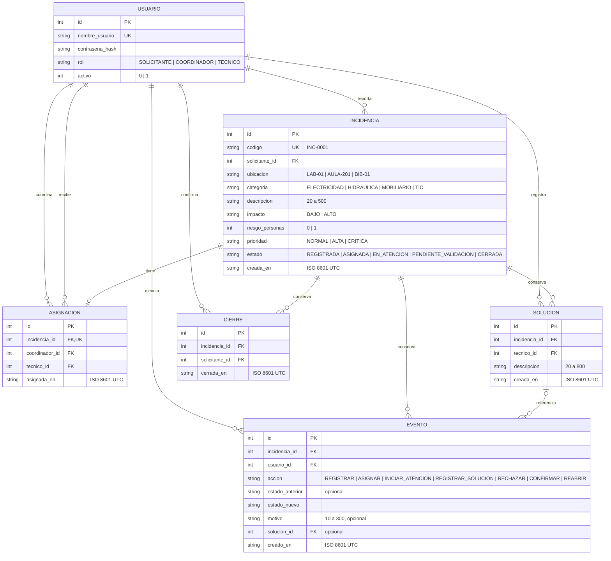

# Modelo de datos de ReparaCampus

**Versión:** 2.0  
**Fuente:** `database/schema.sql` v2  
**Diagrama:** [datos.png](diagramas/datos.png)  
**Estado:** versión propuesta para revisión del equipo en el pull request #20.

## Reglas y restricciones

- Cada incidencia tiene una sola asignación: `asignaciones.incidencia_id` es `UNIQUE`; no se permite reasignar.
- Las soluciones se conservan como registros separados, incluso cuando una es rechazada y se registra otra.
- Cada confirmación agrega un registro a `cierres`; la reapertura se calcula a partir del cierre más reciente, sin borrar cierres anteriores.
- Cada creación o transición exitosa registra un evento con actor, fecha UTC, acción y estados; el motivo y la solución se enlazan cuando corresponden.
- Las restricciones `CHECK`, claves foráneas y triggers del esquema protegen valores permitidos e inmutabilidad del historial y los datos originales del reporte.
- El esquema almacena fechas como texto ISO 8601 en UTC. La prioridad solo admite `NORMAL`, `ALTA` o `CRITICA`; la calcula la lógica de negocio.

La tabla `CIERRE` reemplaza el campo `ultimo_cierre_en` de la versión 1, que no conservaba el historial de varios cierres.