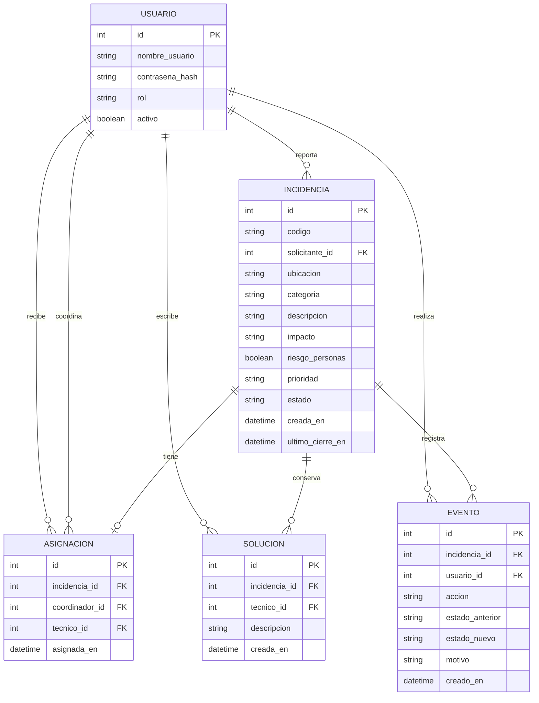

# Modelo de datos de ReparaCampus

**Estado:** Aprobado por el equipo; falta registrar revisor, fecha y observaciones.

## Reglas del modelo

- Cada incidencia pertenece a un solicitante.
- Una incidencia puede tener cero o una asignación; si se asigna, se conserva el coordinador y el técnico responsables.
- Una incidencia puede conservar varias soluciones. Una solución rechazada no se reemplaza ni se borra.
- Cada acción exitosa genera un evento con el actor, la acción, la fecha, el estado anterior y el nuevo; los rechazos y reaperturas guardan también el motivo.
- `ultimo_cierre_en` guarda la fecha del cierre más reciente y sirve para calcular el plazo de reapertura de 48 horas. Al reabrir no se borra ese valor; un cierre posterior lo actualiza.
- Los cierres anteriores permanecen en `EVENTO`, incluso después de una reapertura.
- Las fechas se guardan en UTC. Las restricciones de claves foráneas, valores permitidos e inmutabilidad se implementan en SQLite según `database/schema.sql`.

## Registro de revisión

- **Revisor:** por registrar
- **Fecha:** por registrar
- **Decisión:** aprobado por el equipo
- **Observaciones:** por registrar
