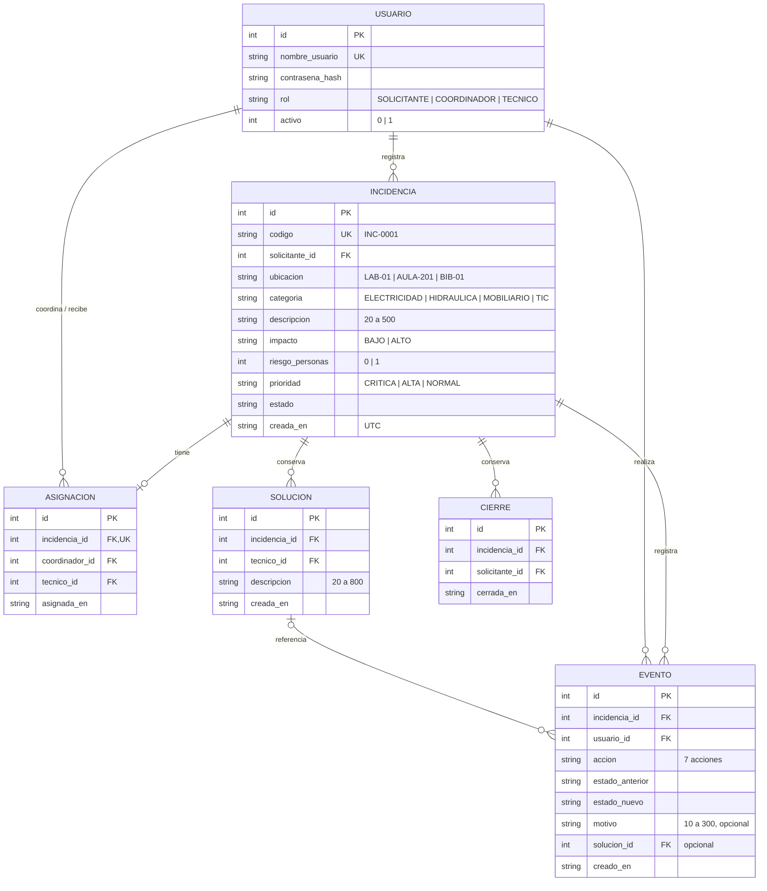

# Modelo de datos de ReparaCampus

**Versión:** 2.0 · **Fuente:** `database/schema.sql` v2 · **Diagrama:** `docs/diagramas/datos.png`

## Reglas del modelo

- Cada incidencia pertenece a un solicitante y tiene como máximo una asignación (`UNIQUE` en `incidencia_id`): no hay reasignación.
- Cada solución y cada confirmación crean un registro nuevo. El último cierre es `MAX(cerrada_en)` y sirve para el plazo de reapertura de 48 horas.
- Cada creación y transición exitosa genera un evento con autor, fecha UTC, estados, acción y, si aplica, motivo o solución.
- Triggers impiden editar o borrar asignaciones, soluciones, cierres y eventos, y modificar los datos del reporte; solo cambia el estado.
- Cambio respecto a la versión 1: la columna `ultimo_cierre_en` se reemplazó por la tabla `cierres`, porque se sobrescribía y no permitía conservar todos los cierres (S04 v1.0, PR #12).

## Registro de revisión

- Revisor: [nombre de quien revise el PR]
- Fecha: [fecha]
- Decisión: [Aprobado | Requiere cambios]
